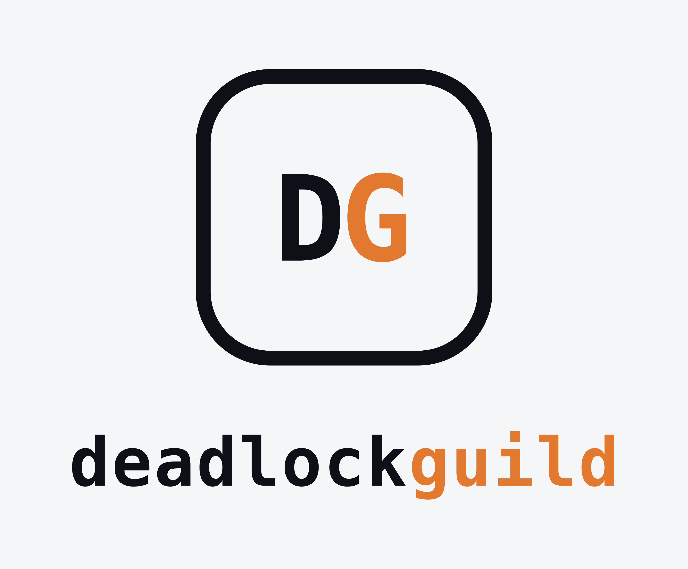

<div align="center">
  
  
  <h1>DeadlockGuild | Documentazione Ufficiale</h1>
  <p><b>Gruppo 17</b> • Ingegneria del Software • A.A. 2026/2027<br>Università degli Studi di Padova</p>
</div>

---

### Consultazione Documenti
La documentazione ufficiale e validata del progetto è consultabile al seguente link: **[https://deadlockguild.github.io/docs/](https://deadlockguild.github.io/docs/)**

## Struttura della Repository

```text
docs/
├── .github/workflows/
├── assets/
├── Candidatura/
│   ├── Verbali/
│   └── template.typ
├── website/
│   ├── index.html
│   └── style.css
└── README.md
```

### Contatti
Per comunicazioni ufficiali è possibile contattare il gruppo all'indirizzo email: **deadlockguild.unipd@gmail.com**

## Membri del Gruppo
<div align="center">

| Nome e Cognome | Matricola |
| :---: | :---: |
| Godwin Agbleze | 2145602 |
| Nikola Miljanovic | 2145601 |
| Carlo Nardin | 2148000 |
| Mattia Pasquato | 1170712 |
| Giacomo Ravazzolo | 2146767 |
| Mattia Scomparin | 2110992 |

</div>
